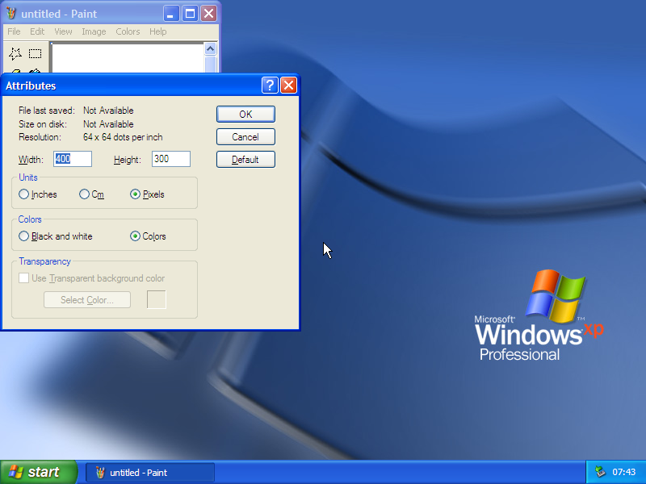

# windows-secrets

Tools for finding the controls that classic Windows programs hide **just off
the edge of their own windows**, plus the data from a full sweep of
Windows for Workgroups 3.11, Windows XP SP3 and Windows 7 SP1.

Write-up: **https://williamsharkey.com/windows-secrets.html**

It started with an AutoHotkey script that dragged the edges of windows that
were never meant to be resized. Growing the Windows XP Paint *Attributes*
dialog uncovers a whole **Transparency** group sitting under its bottom edge:
"Use Transparent background color" and "Select Color...", present and
disabled. These tools turn that trick into a methodical search.



## The two tools

| tool | what it reads | runs on |
|---|---|---|
| `dlgscan` | dialog templates inside `.exe .dll .cpl .mui` files (PE32, PE32+, and 16-bit NE) | Linux, macOS, Windows - no Windows needed |
| `winprobe` | live windows: where every control *actually* is at runtime | Windows XP and later (32-bit build runs on 64-bit too) |

### dlgscan - static

Parses `DLGTEMPLATE`, `DLGTEMPLATEEX` and Win16 dialog resources and compares
each control's rectangle with its dialog's size (both in dialog units).

```
dlgscan [-a] [-m] [-j] [-x] file...
  -a  dump every dialog and control
  -m  dump menus too
  -j  JSON lines
  -x  also report HIDDEN / DISABLED controls inside the dialog
```

Flags: `OUTSIDE` (entirely past an edge), `PARTIAL` (more than half
clipped), `ZEROSIZE` (0 wide or tall but has text or a tab stop), and
with `-x`: `HIDDEN`, `DISABLED`.

```
$ dlgscan WINDOWS/CARDFILE.EXE
CARDFILE.EXE  OUTSIDE  118  dlg=236x62 "Find"  id=1040  checkbox  @4,99 100x12  visible,tabstop  "Match Whole Word Only"
```

### winprobe - runtime

```
winprobe list                        top-level windows
winprobe probe  <win>                every child, flagged OUTSIDE / CLIPPED / GHOST / COVERED / ZEROSIZE
winprobe tab    <win>                walk the real Tab order
winprobe menu   <win>                menu bar with item states
winprobe grow   <win> <w> <h>        force a size, fixed border or not
winprobe reveal <win>                grow until every child control is on screen
winprobe shot   <win|screen> f.bmp   screenshot
winprobe show|enable|check|click <hwnd>   resurrect a ghost and poke it
winprobe crawl  <outdir> <cmdline>   launch a program, open every "..." menu item,
                                     every property-sheet tab and every ">>" expander,
                                     probing and photographing each window
```

`<win>` is `0xHWND`, a title substring, or `class:NAME`.

**Be gentle with `crawl`.** It posts menu commands that real users reach
only in context. On XP it crashed Paint, Regedit and Packager. Use a VM or a
machine you don't mind poking.

## Binaries

`bin/` has prebuilt copies:

- `dlgscan-linux-x64`, `dlgscan-macos-universal` (arm64 + x86_64), `dlgscan-win32.exe`, `dlgscan-win64.exe`
- `winprobe-win32.exe` (XP-compatible), `winprobe-win64.exe`

Build from source:

```
cc -O2 -o dlgscan src/dlgscan.c
i686-w64-mingw32-gcc -O2 -o winprobe.exe src/winprobe.c -lgdi32 -luser32
```

## Data

| | files | unique dialogs | dialogs with an off-canvas / zero-size control |
|---|---|---|---|
| Windows for Workgroups 3.11 | 75 | 456 | 53 (11.6%) |
| Windows XP SP3 | 439 | 4,602 | 113 (2.5%) |
| Windows 7 SP1 | 584 | 5,794 | 97 (1.7%) |

- `data/*-all.jsonl.gz` - every dialog and control (`dlgscan -a -j`)
- `data/*-flagged.txt` - the suspicious ones, deduplicated
- `data/crawl-w7`, `data/crawl-xp` - runtime crawl logs (probe, tab order, menus) per program
- `data/*-runtime-findings.tsv` - runtime flags with text, one per line

## Rigs used

- **Windows 7** - real hardware, driven over SSH; GUI jobs run in the
  console session through a one-shot `schtasks /IT` task (`tools/w7gui.sh`).
- **Windows XP** - QEMU on a droplet, booted with `snapshot=on` so nothing
  persists; keys and screendumps go through the QEMU monitor
  (`tools/xpvm.py`), and tools and results travel on a second IDE disk.
- **Windows for Workgroups 3.11** - DOSBox-X under Xvfb, driven with
  xdotool (`tools/w311.sh`).

## Highlights

- **XP Paint, Image > Attributes** - a whole *Transparency* group below the
  bottom edge. Visible, disabled, so Tab skips it.
- **ChooseColor `&o` button** - a 4-DLU button at (300,200) that exists only
  to carry the Alt+O mnemonic for "Color|S**o**lid". It's in Win 3.11
  COMMDLG and still there in Windows 7.
- **Cardfile 1992 → Notepad 2009** - "Match Whole Word Only" is off-canvas in
  Cardfile and a hidden, disabled ghost in Windows 7 Notepad. Resurrected and
  ticked, it does nothing: Notepad still finds "cat" inside "concatenate".
- **Control Panel International (3.11)** - 1×1 buttons "D", "U", "T", "N" at
  (300,200); Alt+D opens Date Format through an invisible button.
- **XP Turn Off Computer** - a Hibernate button parked at (30093, 30049),
  about 44 screen widths to the right.
- **Task Scheduler (mstask / xpsp2res)** - Weekly, Monthly, Once and Idle
  panels laid side by side out to x=1200 DLU, swapped in at runtime.
- **Test hooks left in** - `ftsrch.dll`: *"No Data: This static is used to
  automate testing"* at (14563,16383); Dr. Watson: *"This is to the right."*

Public domain (CC0).
