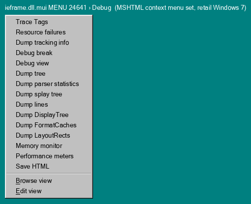
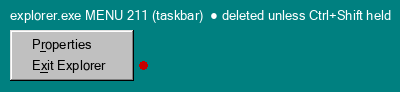
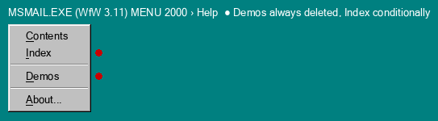
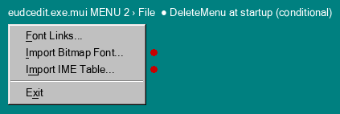
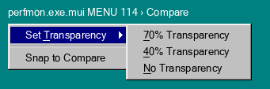
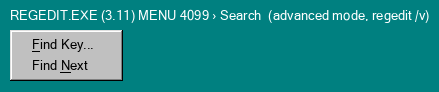

# codehunt: secrets that aren't dialog geometry

`dlgscan` and `winprobe` look at where controls sit. `tools/codehunt.py` looks
at everything else in a binary: string tables, accelerator tables, version
info, debug directories, imports, Win16 relocation tables, and the string
literals the code passes to registry, INI, string-compare, window-message,
DDE and pipe APIs. The raw output is in `data/codehunt-w7.jsonl.gz` (85
Windows 7 SP1 x86 binaries plus their en-US `.mui` files) and
`data/codehunt-w311.jsonl.gz` (all 451 files of the Windows for Workgroups
3.11 install). It has 22,591 candidate records. Orphan-looking icons, cursors
and bitmaps from executables are rendered in `data/codehunt-icons/`.

How the findings were checked:

* **static**: the exact bytes were read and the code that uses them was
  disassembled (capstone, x86-32 for Windows 7 and 16-bit for 3.11; Win16
  imports were resolved through the NE relocation tables).
* No finding was checked at runtime. The Windows 7 box was only copied from,
  read-only, and the Windows 3.11 and XP rigs were not used.
* Anything marked *speculation* is a guess about intent or effect.

## The findings

### Hidden modes and keys in the games and accessories

**1. Hearts 3.11: the `ZB=42` key turns on a Ctrl+Alt+Shift+F12 toggle.**
In `C:\WINDOWS\MSHEARTS.EXE`, accelerator table `HEARTSACCEL` maps
Ctrl+Alt+Shift+F12 (flags 0x9d) to command 121. No menu item has that ID; the
menu runs 101–127 without 121. The handler at seg1:0454 does this:

```
push [0x10] ("Hearts") ; push 0x97 ("ZB") ; push 0 ; call KERNEL.GETPROFILEINT
cmp ax, 0x2a ; jne out          ; only if WIN.INI [Hearts] ZB=42
toggle word [si+0x12] ; InvalidateRect ; CheckMenuItem(GetMenu(), 121, ...)
```

The toggled word is passed to the card-drawing routine (seg1:3ca0) from at
least four call sites. *Speculation:* it switches to drawing every hand face
up, which matches the folklore "ZB cheat". To try it, put `[Hearts]` /
`ZB=42` in WIN.INI and press Ctrl+Alt+Shift+F12. Static only.

**2. Minesweeper 3.1 has three undocumented function keys and a boss key.**
These are in the WM_KEYDOWN handler at seg1:063a of `WINMINE.EXE`
("Minesweeper v3.0a"):

* **F4** toggles sound. It needs `Sound=` ≥ 2 in `winmine.ini` (read with
  default 0, min 0, max 3). The sound path calls
  `SOUND.OPENSOUND`/`SETVOICEACCENT`/`STOPSOUND`/`CLOSESOUND`, the Win 3.x
  speaker-music driver.
* **F5** hides the menu bar and **F6** shows it: `SetMenu(hwnd, NULL)` or the
  saved menu. Both need `Menu=1` or `Menu=2` in `winmine.ini` (default 0, which
  disables them).
* **Esc** sends `WM_SYSCOMMAND SC_MINIMIZE`, which works as a boss key.
* The well-known `XYZZY`+Shift cheat is here too: the string `XYZZY` sits at
  data seg2:0036, a per-key match counter is kept at `[0x34]`, and Shift does
  `xor [0x34],0x14` once all 5 letters have matched.

Static only.

**3. Notepad's `/.SETUP` mode ships in both 3.11 and Windows 7.**
Notepad has a second accelerator table, `SlipUpAcc`, that is never used in
normal runs. It adds **Esc** and **Ctrl+D** as Exit: command 28 in 3.11 and 7
in Windows 7. (The table also maps Ctrl+C and Ctrl+Z to Exit, but those
entries come after Copy and Undo, so `TranslateAccelerator` never reaches
them.)

* **Windows 7** (`notepad.exe` 6.1.7601.18917, code at 0x01002758): the
  command line is compared with `L"/.SETUP"`. A match sets a flag, loads
  `SlipUpAcc`, calls `SetWindowLongW(GWL_STYLE, 0x00FD0000)` (no minimize box),
  opens the named file read-only, and changes `WM_SYSCOMMAND` handling.
* **3.11**: there is no `/.SETUP` string at all. seg2:00e1 compares the
  argument one byte at a time (`'/' '.' 'S' 'E' 'T' 'U' 'P'`), then loads
  `SlipUpAcc`.

That makes this a class of hidden switch that string scanners cannot see. To
try it, run `notepad /.SETUP file.txt` and press Esc. Static only.

**4. Notepad (Windows 7) reads a registry switch named `fMLE_is_broken`.**
It is a DWORD under `HKCU\Software\Microsoft\Notepad`, read at 0x01002f9e into
global 0x0100c040 with a default of 0. At 0x01007c00 and 0x01007ba8 a nonzero
value makes Word Wrap rebuild the edit control (style 0x50200104) instead of
reformatting the existing one with `EM_FMTLINES`. *Speculation:* this is a
workaround switch for a buggy multi-line edit (MLE) control. Static only.

**5. Charmap (Windows 7) has an accelerator table it can never load.**
`charmap.exe.mui` has table `UCE` mapping Ctrl+Home/End/Left/Right/Up/Down/PgUp/PgDn
to commands 121–128. But `charmap.exe` imports neither `LoadAccelerators*` nor
`TranslateAccelerator*`, and the name "UCE" isn't in the code. The keys are
dead. (`*.uce` is the old "Unicode subrange" file filter, so *speculation:*
these belonged to a removed UCE-file feature.) Static.

**6. MMC binds Ctrl+Alt+Shift+F7, but nothing handles it.**
`mmc.exe.mui` ACCELERATOR 128 maps Ctrl+Alt+Shift+F7 (flags 0x1f) to command
13235. A full disassembly of `mmc.exe` and `mmcndmgr.dll` finds no immediate
0x33B3, and the MFC message maps (`11 01 00 00 … b3 33 00 00`) have no entry
for it. Neighbouring IDs 13231 and 13238 are handled. *Speculation:* this is a
debug-build command whose handler was compiled out. Worth checking on XP's
MMC 2.0. Static.

**7. Magnifier (Windows 7) has four undocumented command-line words.**
The parser at 0x010038d3 tokenises the command line with `wcstok` and compares
each token with `CompareStringW`, in this order:

`wait` (sleeps 5 s), `noutilman`, `fullscreen`, `lens`, `docked`, `hilight`, `globalhotkey`.

`fullscreen`, `lens` and `docked` are the documented modes. `hilight` creates
three objects and gives two of them the colours 0x00FF00FF (magenta) and
0x00FFFF00 (cyan). *Speculation:* these are debug overlays that outline the
focus or caret rectangles being tracked. Static.

**8. LogonUI accepts test switches.**
`logonui.exe` (6.1.7601.17514) contains only two UTF-16 strings of its own:
`/flags:` and `/testclientprocessid:`. Both are parsed at 0x01001152 and
passed to a COM method (vtable +0x0C) of the logon UI host. This is a
test-client hook in the logon screen process. Static; the effect was not
traced.

**9. Power Options listens for a `PowerCplTest` window message.**
`powercfg.cpl` registers the message at 0x07b141bf. When it arrives with
wParam=1, the handler (0x07b139bd → 0x07b15e05) finds an item in the
Advanced-settings tree (control 0x451), then sends `TVM_ENSUREVISIBLE`
(0x1114) and `TVM_EXPAND` (0x1102, `TVE_EXPAND`) to it. In other words,
another process can drive the dialog to a setting by posting a registered
message. This is a test-automation hook in a shipping control panel. Static.

**10. dxdiag has a hidden stress-test mode.**
`dxdiag.exe` opens `HKCU\Software\Microsoft\DirectX Diagnostic Tool` at
0x01012a63 and reads these values:

`Never Skip`, `Allow WHQL Checks`, `Stress Scan`, `Stress Skip Stage`, `Stress Page Change`, `Stress Save File`, `Stress Cancel Gather`, and a `… Freq` value for each.

The globals they fill are tested in code:

* At 0x01016765, `Stress Page Change` gates a `SetTimer` call.
* At 0x01014faf, `Stress Skip Stage` gates special handling of stage messages
  0x2bc and 0x2bd.
* At 0x01017e2f, `Stress Scan` gates a call back into the settings reader and
  the scan objects.

*Speculation:* together these make an automated page-flipping and
cancel/save stress loop.

To try it, set the DWORDs to 1. Static only.

### Debug and test residue

**11. MSHTML's Debug context menu is shipped in retail Windows 7.**
`ieframe.dll.mui` MENU 24640 and 24641 include a `Debug` popup with these
items:

`Trace tags`, `Resource failures`, `Dump tracking info`, `Debug break`, `Debug view`, `Dump tree`, `Dump parser statistics`, `Dump splay tree`, `Dump lines`, `Dump DisplayTree`, `Dump FormatCaches`, `Dump LayoutRects`, `Memory monitor`, `Performance meters`, `Save HTML`, `&Browse view`, `&Edit view`

The command IDs are 6004–6017, 7103 and 7104. MENU 24642, the newer
touch-style menu set, has an empty `Debug` slot. *Speculation:* only debug
MSHTML builds pick this popup. The XP copy is in `shdoclc.dll`.

**12. Windows 7 build-tree paths leak through assert and trace strings.**
For example:

* `d:\w7rtm\base\diagnosis\ra\ui\wizard.cpp`, plus 26 more in `msra.exe`.
* `d:\w7rtm\printscan\dox\dcx\viewer\automation\automation.cpp`, plus about 37
  more in `xpsrchvw.exe`. There is a whole `viewer\automation` directory.
* `d:\w7rtm\windows\dwm\shared\util\utillib\debugbreak.cpp` in `dwm.exe` and
  `themeui.dll`.

These show the RTM branch name (`w7rtm`) and the source-tree layout (`base`,
`printscan`, `windows\dwm`). By contrast, every Windows 7 CodeView record in
the sample holds only a bare `name.pdb`. Static, exact strings.

**13. The XPS Viewer carries a placeholder e-mail address and debug switches.**
`xpsrchvw.exe` contains `not.a.real.address@example.com` and reads registry
values `DebugOutputFlags`, `EnableLiveID` and `DisableMMX` (under
`Software\Microsoft\XPSViewer` and `Software\Microsoft\Direct3D`). Its string
table has id 12396, "XPS Viewer has detected that it is being debugged.".
Static.

**14. Charmap in Windows 7 is a Windows Server 2003-era binary flagged as a private build.**
The `VS_FIXEDFILEINFO` of `charmap.exe` and of its `.mui` reads
`5.2.3668.0` with `FileFlags = 8` (`VS_FF_PRIVATEBUILD`). There is no
`PrivateBuild` string. The servicing manifest calls the same file
`6.1.7601.18648` (the WinSxS folder is
`x86_microsoft-windows-charmap_…_6.1.7601.18648_…`), and the link date is
2014-10-30. The 5.2 version line is Windows XP x64 / Server 2003, and 3668 is
lower than the 3790 RTM build. *Speculation:* the version resource was never
updated after a pre-RTM .NET Server build. Static.

**15. The CardSpace control panel names its build machine.**
`infocardcpl.cpl` has `PrivateBuild = "DDBLD145"`,
`Comments = "Flavor=Retail"` and `FileFlags = PRIVATEBUILD`. *Speculation:*
"DDBLD" means a Developer Division build machine, because CardSpace shipped
with .NET 3.0. Static.

**16. Placeholder text left in Action Center.**
`wscui.cpl.mui` strings 2100–2105 are:

`Check Description`, `Notifcation Description` [sic], `Show Me More Information about foo`, `Balloon Title`, `Balloon Description`, `State Description`

None of the IDs 2100–2105 appears as an immediate in `wscui.cpl`.
*Speculation:* these are template or default strings. Static.

**17. Calculator (Windows 7) has typos in its persisted state names.**
The state names that Calculator passes to its registry calls under
`Software\Microsoft\Calc` include `Unit_Converion_history`
next to the correctly spelled `Unit_Conversion_data`, and
`datettime_datestart` next to `datetime_*`. The resource name constant
`IDS_TEMPALTE_XML` is also misspelled. There are leftover developer
diagnostics too: `Duplicate Formula: `, `Undefined unit or arg: `,
`Setting Data on Unit in Combobox failed`, and
`ErrorCode: %d, Line: %d Column: %d; Error: %s`. Static.

**18. On-Screen Keyboard calls its default skin "Longhorn".**
`osk.exe` compares a skin or theme name with `L"Longhorn"` in six places, for
example `_wcsicmp(arg, L"Longhorn")` at 0x01019342; the alternative is
`L"Classic"`. `authui.dll` also has a `Longhorn` string next to
`InsideWindow`/`True`/`False`. This is the Vista codename still in Windows 7.
Static.

**19. Windows 3.1's hidden credits can be decoded from SHELL.DLL.**
`SYSTEM\SHELL.DLL` has RCDATA 9999 (2,064 bytes) and BITMAPs 9997/9998 that
no dialog or menu uses. XOR-ing the RCDATA with **0x99** gives the full roll
for the well-known 3.1 About-box easter egg. It opens with "Dedicated to all
the hard-working people of the Microsoft Windows 3.10 Team!", followed by
`Lead by/BRADSI`, Development (`KARLST`, `PHILBA`, …), Program Management,
Testing, Multimedia, OLE, WinHelp, Fonts, Beta, Marketing, Documentation,
Graphic Artists, and `Special Thanks/to billg/mikehal/steveb/t-bear`. The
easter egg itself is known; the codec here was derived from the bytes.
Static.

**20. Win16 module descriptions credit authors and keep codenames.**
These come from the NE non-resident name #0, which is never shown in the
UI:

* `CALC.EXE`: "Microsoft Calculator: Developed by Kraig Brockschmidt".
* `PBRUSH.EXE`: "PC Paintbrush+" (ZSoft heritage).
* `WINMINE.EXE`: "Minesweeper v3.0a". The string table also has
  "by Robert Donner and Curt Johnson".
* `STORE.DLL` / `VFORMS.DLL`: "**Bullet** Store DLL" / "Bullet VFORMS DLL".
  *Speculation:* Bullet was the codename of the Mail 3.x client; `MSMAIL.EXE`
  and `STORE.DLL` also contain the INI-style name `HiddenBullet`.
* `MSSFS.DLL`: "Network Courier service provider DLL", from Courier, the
  product MS Mail grew out of.
* `RASSTART.EXE`: "retail\RASSTART.exe", a build-tree path.

Static.

**21. Beta time-bomb text ships in retail Schedule+ 3.11.**
"Sorry, this Beta copy has expired." is in `SCHDPLUS.EXE`, `MSSCHED.DLL` and
`MSREMIND.EXE`. `MSMAIL.EXE` credits its spell checker with
"1984-1993, Trade Secret, Soft-Art, Inc.". Static strings; whether the
expiry code is still reachable was not traced.

**22. Exported names with "hack" and "debug" in them (3.11).**
`COMMDLG.DLL` exports `DWUPARROWHACK` (ordinal 30). `DLLSCHED.DLL` exports
`_DEBUGPRINTF`. `MSSCHED.DLL` exports `ECTESTSCHEDFILE`. `FRAMEWRK.DLL` exports
`PANEAUX_EVRDUMPSTATE`. `KRNL386.EXE` reads `EnableEMSDebug`. `WINTUTOR.EXE`
has a "Test mode" string. Static.

**23. Undocumented INI switches in 3.11.**
These are literals passed directly to `GetProfileInt`/`GetPrivateProfileInt`
or `…String`, so the code really does read them:

* `USER.EXE` reads `[Windows] Edsun=` at seg3:2288 into a global. Edsun was
  the maker of the CEG anti-aliasing RAMDAC.
* `PBRUSH.EXE` reads `OmitPictureFormat`.
* `CARDFILE.EXE` reads `ValidateFileWrite`.
* `CLOCK.EXE` reads `NoShadow`.
* `CONTROL.EXE` reads `[MMCPL] NumApps` and `"don't load"`.
* `DDEML.DLL` reads `ShutdownTimeout`/`ShutdownRetryTimeout`, and adds a
  `Progman` atom.
* `STORE.DLL` reads `No_Compress` and `Secs_Till_Fast_Compress`.

Static. What these values do beyond being read was not traced, except for
Edsun.

### Ways to drive a program from outside

This is the `surface`, `api_arg` and `cmdline` part of the data.

**24. Registered messages, DDE names and pipes that other programs can use.**

* Windows 7 WordPad registers `WordPadOpenMessage` and `WordPadPrinterChanged`.
* Explorer registers `SHELLHOOK`, `Logoff User`, `HardError`, `SysFrostedWindow`,
  `Enable Balloon Tip`, `ShowOnlyQuickLaunchDeskBand`.
* Defrag registers `WindowsDefrag{DD9F21BA-…}`.
* MMC registers `CAMCView::JiggleListViewFocus` and `CAMCView::ShowWebContextMenu`.
* ieframe uses the classic Netscape DDE topics `WWW_OpenURL`/`WWW_URLEcho` and
  registers `CMBAutomation` and `GetAutomationObject`.
* `mstsc.exe` contains the RPC endpoint `\pipe\SessEnvPublicRpc` (an
  `ncacn_np` client binding).
* Program Manager 3.1 registers `OTHERWINDOWCREATED` and `ACTIVATESHELLWINDOW`.
* ClipBook (`CLIPSRV.EXE`) is a DDEML server under the service name
  `ClipSrv`, with topics `System`, `Topics`, `FormatList` and `CLPBK$` shares.
* The 3.11 screen savers register `PWM_NEWSPEED` and `PWM_NEWPOSITION`.
* NetDDE registers `NetddeSessionEnum` and `NetddeGetClientInfo`.

All are static: each string is the literal pushed right before the API call.

**25. Hidden command-line switches found by the compare and parse scan.**

* `mstsc.exe /ADMIN` (documented) together with `REGSERVER`, `UNREGSERVER`
  and `EMBEDDING`.
* `fxscover.exe /COMMON /CONVERT /SSESS_ID`.
* `msra.exe -RecoverDesktop`.
* `explorer.exe /FACTORY` and `/globalhotkey`.
* `regedit.exe regserver` / `unregserver`.
* `tabcal.exe Quiet`.
* The `/restart` used by Restart Manager in `calc.exe`, `mspaint.exe`,
  `wordpad.exe` and `StikyNot.exe`.
* `perfmon.exe`: its string table has a switch table
  (`sys`, `res`, `rel`, `report`, `noelev`, `load`, `open`, `comp`, plus
  `` debug`d`level`Debug `` at id 15100). `/comp` ("Enable compare") and
  `/debug` are not in the usual documentation. Their handling was not traced.

Also, `SoundRecorder.exe`, `mmc.exe`, `mstsc.exe` and `xpsrchvw.exe` call
`CoRegisterClassObject`, so they run as COM local servers. `mstsc`, `mmc`,
`wscui` and `appwiz` embed a TYPELIB.

## Hidden menus

These come from the codehunt classes `menu_unloaded`, `menu_runtime`,
`menu_odd` and `menu_nohandler`.

* `menu_runtime` matches the immediate IDs pushed before calls to
  `DeleteMenu`/`RemoveMenu`/`ModifyMenu`/`InsertMenu`/`EnableMenuItem`
  (Win16: `DELETEMENU`/`CHANGEMENU`/...) against the module's menu item IDs.
* The mock-ups in `data/codehunt-menus/` are drawn from the resource by
  `tools/menumock.py`; they are not screenshots.
* "Live" below means: I started the program on the Windows 7 box in the
  console session (via `tools/w7gui.sh`), read its real menu with
  `winprobe menu` or `GetMenu`/`GetSystemMenu`/`GetWindowLong`, and then
  killed it with `taskkill /f`, so it never got the chance to save settings.

**H1. MSHTML's Debug context submenu (ieframe.dll.mui MENU 24640/24641).**
This is a 17-item popup: Trace Tags … Save HTML, Browse view, Edit view
(listed in finding 11). It sits in the same menu resource as the normal page
context menus ("Default", "Image", "Table", "Anchor", …). MENU 24642, the
newer set, keeps a `Debug` slot that is empty. Static.


**H2. Explorer's "Exit Explorer" (explorer.exe MENU 211 = Properties, Exit Explorer).**
At 0x0108aba2 Explorer loads menu 0xD3 (211) and calls
`GetAsyncKeyState(VK_SHIFT)` and `GetAsyncKeyState(VK_CONTROL)`. Unless both
are held, it calls `DeleteMenu(0x7ff4 = 32756)`. It also deletes the item when
the `DisableTaskMgr` policy is set. So **Ctrl+Shift+right-click** on the
taskbar shows **Exit Explorer**. This is folklore, but now confirmed from the
code. Static.


**H3. Mail 3.11 always removes Help ▸ Demos (MSMAIL.EXE MENU 2000).**
At seg40:06f6 the code does `GetSubMenu(GetMenu(), 5)` and then
`DeleteMenu(0xA8F "&Demos")`. If that call succeeds, it also deletes the
separator at position 3; if it fails, it greys the item. "&Index" (0xA8E) is
deleted only when a global flag (`es:[0xdc0]`) is set. The WfW 3.11 build
never shows Demos. Static.


**H4. Private Character Editor hides its Chinese and Japanese import items.**
The routine at 0x01019070 does this:

* If the editor's language global is not 0x404 (zh-TW) or 0x804 (zh-CN), it
  deletes "IME &Link…" (32791) and "I&mport IME Table…" (32802).
* If the global is not 0x411 (ja-JP), it also deletes "&Import Bitmap Font…"
  (32798).
* It then calls `DrawMenuBar`.

**Live:** when the editor is first opened on this English Windows 7, all
three items are still in the menu (File: Import Bitmap Font, Import IME
Table; Edit: IME Link). So the removal happens later, on an event I did not
trace.


**H5. Perfmon's "Compare" menu (perfmon.exe.mui MENU 114).**
The menu bar is File / **Compare** / Help, and Compare holds Set Transparency
(70%, 40%, No transparency) and Snap to Compare. It pairs with the
`` comp`comp`*`Enable compare `` command-line entry in the string table (see
finding 25). `perfmon.exe` never loads menus by immediate ID; `wdc.dll`
imports `LoadMenuW`, so the ID probably comes from data. *Speculation:*
`perfmon /sys /comp` shows it. Static only, because `perfmon.exe` asks to
run elevated (`highestAvailable`) and I didn't trigger a UAC prompt.


**H6. Paint (Windows 7) keeps a vestigial menu bar.**
`mspaint.exe.mui` MENU 2 is a single `&Help` popup containing only an empty
end item. The Windows 7 Paint ribbon has no menu bar. **Live:**
`winprobe menu class:MSPaintApp` printed `(no menu bar)`.


**H7. Notepad's `/.SETUP` mode, checked live (follows up finding 3).**
The menu is unchanged, but the frame changes. I opened `cat.txt` once
normally and once with `/.SETUP`:

| | normal | `/.SETUP` |
|---|---|---|
| style | `0x14CF0000` | `0x04FD0000` |
| visible | yes | no (`WS_VISIBLE` is off) |
| minimize box | yes | no |
| vertical/horizontal scroll bits | not set | set |

So Setup gets an invisible, non-minimisable Notepad. Live check of the style
only; I did not send Esc, so the `SlipUpAcc` exit keys are still static only.

**H8. 3.11 Registration Editor's advanced menus (REGEDIT.EXE MENU 4098/4099).**
4098 is the normal File-type editor. 4099 adds Save Changes, Restore To Last
Save, Save Registration File, a **Search** menu (Find Key, Find Next) and
Add/Copy/Delete Key. The class menu is set to 0x1003 (4099) only when a
command-line flag bit (`[0x2d2] & 4`, the documented `regedit /v`) is set,
at seg1:0744. My `menu_unloaded` class flagged both menus because the ID
reaches `WNDCLASS` through `mov [bp-8], 0x1003`. That's a known limit.


**H9. Other menu items removed at runtime (static; conditions partly traced).**

* `taskmgr.exe` deletes "Set &Affinity…" (40055), "&New Task (Run…)" (40001)
  and "&Restore" (40064).
* `regedit.exe` deletes "Select &All", "&Connect Network Registry…" and
  "&Disconnect Network Registry…".
* `explorer.exe` removes "&Peek at desktop" (6702) and "&Undo" (416).
* `calc.exe` removes "&Date calculation" (979). **Live:** it was present in
  the menu.
* `mmc.exe` deletes "He&lp on Snap-in" and "A&bout Snap-in".
* `bthprops.cpl` deletes the "Turn Adapter On/Off" items.
* In 3.11, `PRINTMAN.EXE` deletes the network-printer items, `SOUNDREC.EXE`
  deletes "Paste Insert" and "Paste Mix", and `CMC`/`MAPI`/`VFORMS` delete
  "Spe&lling F7".

**Menu false positives:**

* `dialer.exe` MENU 118 looked unloaded, but live it has a menu bar (set
  through the window class).
* `mmsys.cpl` MENU 603 ("Show Disabled Devices", "Show Disconnected Devices")
  is the familiar right-click menu, loaded by an ID my scan did not catch.
* The `menu_nohandler` class is mostly MFC or ATL command routing that
  immediates can't see. Treat it as weak evidence.

## Limits and false positives

* `res_unref` and `res_unref_image` only catch direct immediates.
  * Windows 7 regedit's "Binary Data" DIALOG 2021 looked orphaned, but it is
    loaded as `DialogBoxParamW(…, 0x7e4 + (arg != 0), …)` at 0x01017dcd.
  * Card faces, toolbar strips and ribbon images are referenced as base+n or
    from the ribbon markup.
  * Of the 208 PNGs in `data/codehunt-icons/`, most are program or tray icons
    used through such tables, not lost art. Nothing there was clearly unused.
    The Schedule+ "cowboy" bitmaps 1147/1149 have no direct reference, but
    that was not traced further.
* `codename` hits need context. `OLE2CONV.DLL`'s "Chicago" and "Cairo" are
  Macintosh QuickDraw font names (next to "New York", "Geneva",
  "Los Angeles"), not the Windows 95/NT codenames.
* `api_arg` collects every string pushed within 64 bytes (PE) or 48 bytes
  (NE) before the call, so neighbouring calls bleed into one record. Read
  `args` as candidates.
* Inline character compares, like 3.11 Notepad's `/.SETUP`, are invisible to
  any string-based scan.

## XP ideas to check later (the VM was not touched)

1. `shdoclc.dll`: is the MSHTML `Debug` context submenu (finding 11) there,
   and does any registry switch enable it?
2. `mmc.exe` (MMC 2.0): Ctrl+Alt+Shift+F7 / 13235. Is it handled in this older
   version?
3. Notepad 5.1: `/.SETUP`, `SlipUpAcc` and `fMLE_is_broken`, completing the
   1992 → 2001 → 2009 line.
4. `winmine.exe` (XP): `Sound`/`Menu` values now in
   `HKCU\Software\Microsoft\winmine`; F4/F5/F6 and the XYZZY handler.
4b. XP Explorer: is there a taskbar "Exit Explorer"? (Windows 7 has it behind
    Ctrl+Shift, H2.) Also check XP `shdoclc.dll` MENU 24641 against H1.
5. `mshearts.exe`: `ZB=42`, now in
   `HKCU\Software\Microsoft\Windows\CurrentVersion\Applets\Hearts`.
6. `freecell.exe` / `sol.exe` / `pinball.exe`: run the accelerator and
   key-handler analysis, and look at the Space Cadet cheat strings.
7. `dxdiag.exe` (DirectX 9c): are the `Stress *` values already there?
8. `magnify.exe` and `osk.exe` (XP): command words and skin names.
9. `charmap.exe` (XP): what its version resource says against the 5.2.3668
   seen in Windows 7.
10. XP SP3 CodeView records often keep full `d:\xpsp\…` or `\\`-style paths.
    Run the `pdb` class across `system32`.
11. Run `codehunt --icons-dir` on XP `shell32.dll`/`moricons.dll` for icons
    no longer in any index table.

## Reproduce

```
python3 tools/codehunt.py --mui w7/en-US --icons-dir icons  w7/System32  > codehunt-w7.jsonl
python3 tools/codehunt.py --icons-dir icons  wfw311/              > codehunt-w311.jsonl
```

It uses only the standard library. Pillow is optional and needed only for
`--icons-dir`. Run it with plain `python3` (or `-s`) if Pillow is in the user
site.
